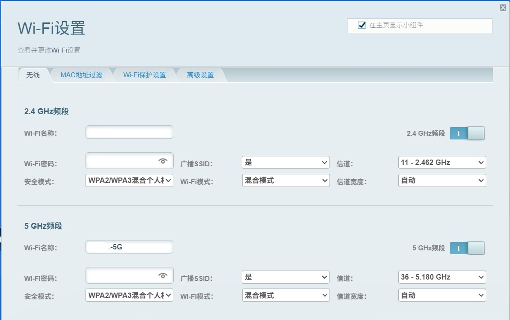

| 项目 | 说明 |
|---|---|
| 文档类型 | 排障记录（Troubleshooting Report） |
| 排障日期 | 2026-11-04 |
| 排障对象 | Switch 全系（含 OLED）只能看到并连接 2.4GHz SSID，5GHz SSID 在扫描列表中完全不存在 |
| 最终状态 | 已定位根因，问题出在 5GHz 信道超出 Switch 区域固件白名单，与加密方式、协议版本无关。 |

---

## 一、背景

前文：[在 WiFi 5GHz 频段下社交平台图片加载缓慢问题](./2026_09_08.md)

- 设备：Nintendo Switch OLED
- 现象：我的 Nintendo Switch OLED 主机 WiFi 扫描列表中可以正常看到并连接 2.4GHz 频段，但 5GHz 频段 **完全不出现**在扫描结果中。
- 特征：**扫描阶段即不可见**，主机静默使用 2.4GHz 完成联网。

---

## 二、环境信息

| 项目 | 内容 |
| --- | --- |
| 路由器 | Linksys MBE7000（Velop Pro 7 mesh） |
| 固件版本 | 1.0.13.216765 |
| 频段能力 | 2.4GHz + 5GHz + 6GHz 三频 |

---

## 三、根因

### 3.1 直接原因：5GHz 信道落在 Switch 白名单之外

- Nintendo Switch 全系（含 OLED）的 5GHz 无线网卡受**区域固件白名单**限制，仅支持以下 4 个信道：

  | 支持信道 | 频点 | UNII 段 |
  | --- | --- | --- |
  | 36 | 5180 MHz | UNII-1 |
  | 40 | 5200 MHz | UNII-1 |
  | 44 | 5220 MHz | UNII-1 |
  | 48 | 5240 MHz | UNII-1 |

- **不支持** UNII-3 段（149–165）与 DFS 段（52–64、100–144）。
- 本案例中路由器自动选频结果落在**信道 153**（80MHz 频宽，实际占用 149–161），Switch 扫描时该信道不在白名单内，故完全扫不到该 SSID，并静默回退到 2.4GHz。

### 3.2 排除项

在与 Marvis 研究过程中，实测两个频段使用完全相同的安全与协议配置：

- 均为 **WPA2 / WPA3 混合模式**（非 WPA3-only）；
- 均**未启用 ax-only**（2.4G/5G 兼容性降级路径保留）；
- 信标帧中包含传统速率元素与 VHT 元素，对老设备兼容。

因此可以推定：**加密与协议不是影响其的主要原因，解决信道问题，Switch 即有大概率能够正常识别 5GHz 了。**

---

## 四、排查路径

| 步骤 | 操作 | 目标 |
| --- | --- | --- |
| 1 | `netsh wlan show interfaces` + `netsh wlan show networks mode=bssid` | 确认路由器实际使用的信道与频宽 |
| 2 | 核验游戏机 5GHz 信道白名单 | 确认 Switch 仅支持 36 / 40 / 44 / 48 |
| 3 | 检查路由器信标中的安全与协议配置 | 排除 WPA3-only、ax-only 等兼容性问题 |
| 4 | 寻找路由器改信道入口 | Linksys App 无手动信道项，仅提供 Channel Finder 自动选频 → 改走本地 Web UI `https://192.168.1.1` → 点击页脚右侧隐藏的 **CA** 链接进入完整配置树 |

::: note 步骤 1 用于 “确认目前设备所连接的路由器实际使用的信道与频宽” 的命令示例

```powershell
netsh wlan show interfaces
netsh wlan show networks mode=bssid
```

在确认相关设置时，需要重点需要查看输出中的 `Channel`（信道）与 `Band`（频段）字段，确认 5G 当前落在 149–165 区间还是 36–48 区间。

:::

::: tip Linksys 的后门

Linksys 的路由器在本地 Web UI中，登录之后原本是无法正常自定义配置信道的。但是点击页脚右侧隐藏的 **CA** 链接，它就会跳转进入完整配置树。感觉像是专门留了个后门的某种“里技”一样的存在了……

:::

---

## 五、修复方法

在使用 CA 链接进入完整配置树后，寻找页面路径 `Wi-Fi 设置 → 无线` 里 将 5GHz 信道固定为 **36**，信道宽度保留"自动"（实际仍协商 80MHz）



::: tip 关键操作前提：关闭 Auto Channel Finder

- MBE7000 出厂默认开启 **Auto Channel Finder**，约每 **5 天**自动重新扫描环境并选频，该选频**会覆盖手动设置的信道**。 若未关闭，手动固定的信道会被其自动拨回其他信道，可能会使得 Switch 再次搜不到 5GHz。
- Linksys App 中针对其的关闭路径如下：`Wi-Fi 设置 → 寻找到 “5 GHz 频段” 区块 → 高级 Wi-Fi 设置 → 通道查找器 → 自动频道查找器` → **关闭**。

:::

---

## 六、修改前后实测对比

| 项目 | 修改前 | 修改后 |
| --- | --- | --- |
| 5G 信道 | 153（5765 MHz） | 36（5180 MHz） |
| 5G 频宽 | 80 MHz，占用 149–161 | 80 MHz，段中心 5210 MHz |
| 5G 信号强度 | 82% | 80% |
| 5G 协商速率（收/发） | 649 / 324 Mbps | 649 / 480 Mbps |
| Switch 能否搜到 5G | 否 | 是，可正常连接 |

**结论：**

- 5G 落在 **W52（UNII-1）段** 的信道 36，处于 Switch 白名单内，主机可正常识别并建立连接。
- Marvis 测试后发现，同样连接 5GHz 的本机的上行速率从 324 Mbps 提升到 480 Mbps，说明 80MHz 频宽协商未受影响。

::: info

在通过 CA 页面固定 5G 信道的同时，我顺手把 2.4G 信道从原来的 “自动” 修改为固定 **11**。1 / 6 / 11 是 2.4GHz 三个互不重叠信道，选择 11 属于合理避让，不会与邻居的 1、6 信道重叠。

:::

---

## 七、信道环境分析原理

我向 Marvis 进行的提问：“你是如何知道邻居 AP 集中在哪一个信道的？”其做出如下回答：

### 7.1 Beacon 信标帧被动扫描机制

首先，Windows 扫描 WiFi 列表依靠的是**被动接收 AP 广播的 Beacon 信标帧**，其拥有如下特点：

1. **无需连接、无需密码**即可获得该 AP 的全部基础信息；
2. Beacon 每秒约广播 **10 次**（默认 Beacon Interval 100 TU ≈ 102.4 ms）；
3. 信标帧中携带有关键信息单元（IE），其详细键值对描述如下：
    - **SSID IE**：网络名称；
    - **BSSID**：AP 的 MAC 地址（即发送方地址）；
    - **DS Parameter Set IE**：当前工作信道（`netsh` 输出中的 `Channel` 即来源于此）；
    - **RSN IE**：加密类型（WPA2 / WPA3、AKM 套件等）；
    - **RSSI**：接收信号强度（Windows 侧对应 `wlanSignalQuality`）。

这也解释了为什么"扫描列表里能看到但从没连过"的网络信息依然很完整——因为信息全部来自这个信标帧广播，而非实际连接后的协商结果。

### 7.2 原始扫描结果

这里提供了一些扫描结果，相关名字由于隐私原因已作处理：

| SSID / 标识 | 信道 | 信号 |
| --- | --- | --- |
| A | 5 | 92% |
| B | 6 | 72% |
| C | 7 | 67% |
| D | 11 | 87% |
| D-5G | 36 | 67% |
| （隐藏）c6:68:d0:81:XX:28 | 40 | 29% |
| F-HKBN-5G-Guest（d6:68:d0:81:XX:28） | 40 | 26% |
| G（c4:68:d0:81:XX:28） | 40 | 26% |
| H | 157 | 83% |

::: info 特定数据解读

- **信道 40 上的三条记录实为同一台设备**：OUI 相同（`68:d0:81` 前缀相同），且末字节同为 `:28`，说明 "主 SSID `G`、Guest SSID `F-HKBN-5G-Guest`、隐藏 SSID `（隐藏）`" 实际应为同一台 HKBN 路由器的多个虚拟接口，**不是三台独立设备**。因此在此做信道占用统计时，应将上述 SSID / 标识 合并计 1 个干扰源，否则会高估 40 信道的拥挤程度。
- **信道 157 上的 `H` 信号高达 83%**：该信道属于 UNII-3 段，对 Switch 而言是不可见信道。如前文所述，由于其对于  Switch 而言不可见，因此即使信号再强，Switch 也无法使用。

:::

### 7.3 RSSI 换算

当尝试确认 RSSI（Received Signal Strength Indicator，设备接收到的无线信号功率） 值时，由于 Windows 的 `netsh` 只暴露 `wlanSignalQuality`（0–100 的百分比），不直接给出 dBm 值，因此可按下式近似换算该值：

```
RSSI(dBm) ≈ 信号百分比 ÷ 2 − 100
```

例：信号 67% → 67 ÷ 2 − 100 = **−66.5 dBm**。

::: note

该换算为**近似值**，实际映射曲线由驱动实现决定，仅用于横向比较不同 AP 的相对强弱，不宜用于精确链路预算计算。

:::

---

## 八、踩坑记录

这里记录了在排障时可能会出现的坑。需要注意：

| # | 坑点 | 现象 | 应对 |
| --- | --- | --- | --- |
| 1 | `netsh wlan show networks` 读的是驱动缓存 | 首轮可能只返回 1 条结果，误以为环境干净 | 先触发一次 `WlanScan`（或在系统 WiFi 面板点击刷新）再读，必要时等待数秒重试 |
| 2 | 一上来就排查加密 / 协议 | 花大量时间在 WPA3、WPA2 混合、ax-only 上反复试 | Switch 搜不到 5G 的**典型原因是信道超出白名单**，在该案例中应优先核对信道 |
| 3 | 改了 CA 信道但忘记关 Auto Channel Finder | 数天后信道被自动改回 153，问题复发 | 先关闭 Channel Finder 再改信道，并把"是否关闭自动选频"写入变更检查清单 |
| 4 | CA 模式入口非常隐蔽或者并没有该模式入口 | 在常规 Web UI 里找不到信道设置项 | 入口在**页面最底部右侧、紧邻固件版本号旁边的小字 `CA`**；其他版本的固件是否保留因型号而异，需自行确认；亦可以尝试寻找其他方法 |

---

## 九、备用方案（若无法改信道）

按优先级排列：

1. **有线连接（推荐）**
   Switch OLED 底座自带 LAN 口 ，将网线接到主路由 LAN 口即可走有线。

2. **2.4GHz 将就使用**
   联机对战的实际带宽需求仅数 Mbps，延迟与稳定性在 2.4GHz 上通常也能满足；**只有下载游戏 / 更新时速度会明显受影响**（2.4GHz 实测下行远低于 5GHz）。属于"能用但不快"的兜底选项。

---

## 十、结论与要点总结

> **一句话结论：Switch 搜不到 5G，先查信道白名单——把路由器 5GHz 信道固定到 36 或 44 即可；改完必须关掉自动选频，防止被回跳。**

要点清单：

1. Switch 全系 5GHz 仅支持 **36 / 40 / 44 / 48** 四个信道，UNII-3（149–165）与 DFS（52–64、100–144）一律不可见。
2. 现象是"搜索列表里根本没有该 SSID"，而非"搜到连不上"——这是信道白名单问题的典型指纹。
3. 加密与协议（WPA2/WPA3 混合、非 ax-only）在本次案例中已实测排除，不作为首要怀疑对象。
4. Linksys MBE7000 的 App 端没有手动信道项，必须走本地 Web UI 的 **CA 隐藏入口**（`https://192.168.1.1` → 页脚右侧小字 CA → `Configuration → Wi-Fi → Basic Wireless Settings`）。
5. **Auto Channel Finder 必须关闭**，它是"改了又变回去"的元凶，默认每 5 天自动重扫覆盖。
6. 改后实测：5G 从信道 153（5765 MHz）变为信道 36（5180 MHz），80MHz 频宽保留，Switch 正常识别并可连接。
7. 无法改信道时的兜底先后顺序：有线连接 → 2.4GHz 将就。

::: note
*内容 85% 由 Marvis 调用 LLM 生成，存在人工校对，但依然仅供参考*
:::
