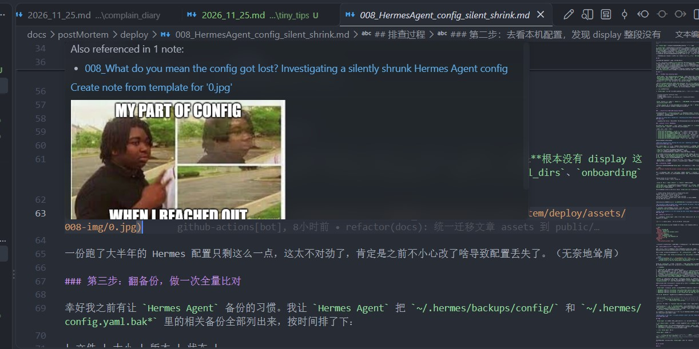

虽然我这个博客在部署到 `GITHUB Pages` 的时候，像是 `图片/GIF` 这些资源都会因为文件 `SHA` 一样，而在编译之后直接合并成同一个文件，这样无论是哪种语言都会只引用同一个资源，但是之前在设计让 `Hermes Agent` 帮忙做自动翻译的时候，给它定下了“每次翻译如果存在图片就需要复制一份过来”的步骤。

虽然这样看似方便我做图片引用啥的，但是想到让它每次翻译都要复制一份还是太麻烦了。于是今天顺手让 `Hermes Agent` 帮忙整理了下博客图片文件，让它统一把文件放到 `.vuepress/public` 底下，这样只要用同一个路径就可以引用同一个文件了。

::: info VuePress 的路径解析

VuePress 将 `.vuepress/public` 作为静态资源目录。该目录下的文件会被复制到最终生成的网站根目录，因此根目录下的:

`docs/.vuepress/public/blog_assets/a/b/assets/img/001.png`

在这个网站中就会对应到：

`/blog_assets/a/b/assets/img/001.png`

VuePress 官方文档对此有明确说明：

- `.vuepress/public` 是默认的公共静态资源目录。
- 其中的文件会被复制到生成的网站根目录。
- 可以通过根绝对路径引用这些文件。

（我现在使用的 VuePress 版本是`2.0.0-rc.31`，相关配置具体可以参考 [这里](https://v2.vuepress.vuejs.org/zh/guide/assets.html)）
:::

但是 `VSCode` 原生 `Markdown` 支持对资源路径的查找的规则不同，导致在 `VSCode` 的 `Markdown` 编辑器中，鼠标悬停在 `` 的图片链接上时，`VSCode` 弹出的 `Hover` 窗口无法像以前一样显示图片了。

::: info VSCode 的路径解析

VSCode 原生 `Markdown` 支持对文件夹路径存在另一套规则：

1. `/` 开头的路径：相对于当前 `Workspace` 根目录解析。
2. `./` 或不带前缀的路径：相对于当前 `Markdown` 文件所在目录解析。

因此，当我写 `/blog_assets/a/b/assets/img/001.png` 的时候，VSCode 会尝试直接查找 `Workspace` 根目录下的：

`/blog_assets/a/b/assets/img/005_002.png`

而不是前文所述的：

`docs/.vuepress/public/blog_assets/a/b/assets/img/001.png`

导致文件路径无法匹配……

具体可以参考[这里](https://code.visualstudio.com/docs/languages/markdown)
:::

::: note  Hover 窗口 - Markdown 图片和视频路径的 Hover 预览功能

`VSCode` 的 `Markdown` 图片和视频路径的 `Hover` 预览功能是 `VSCode` 在 `1.89` 版本中正式加入的。

官方在更新中说明说：
> You can hover over an image or video path to see a small preview of it.

官方更新说明可以参考 [Visual Studio Code 1.89 — Hover to preview images and videos in MarkdownVS Code](https://code.visualstudio.com/updates/v1_89)

:::

之前是一直用这个预览功能交叉参考说引用正不正确的，一下没了还有点不方便……于是决定看看怎么搞。

原来想得太麻烦，又搞 workspace 定义的，又搞插件的，结果后面意识到说，“我加一个软链接不就好了吗”

于是就在根目录下 "Run CMD as Administrator"，然后使用以下指令：

```
mklink /D blog_assets docs\.vuepress\public\blog_assets
```

创建了一个软链接。

最后在 `.gitignore` 里面新增:

```
...
# VS Code Markdown Hover image preview
/blog_assets
...
```

就可以正常使用hover 功能了。



（截图所对应的页面[在这里](../deploy/008_HermesAgent_config_silent_shrink.md)）

::: warning 用 LLM 查找消息的时候，建议统一以官网为准，SNS社区的帖子*仅供参考*

我最开始被[这个哈皮火山引擎](https://www.volcengine.com/article/2371862) 骗了，告诉我说：

> 可以通过调整 `VSCode` 的 `Markdown` 预览设置，直接设置 `{"markdown.preview.rootPath": "${workspaceFolder}/docs\.vuepress\public"}` 将`docs\.vuepress\public`目录设为预览根目录


结果官方实际上就**没有**这个所谓 `"markdown.preview.rootPath"` 的设置，翻了半天没翻出来……我就在猜可能国内的 LLM 很中意火山引擎，寻思都一家人还希望优先拉兄弟一把吧大概……但是这个配置不存在，消息是错的啊大哥……

:::
